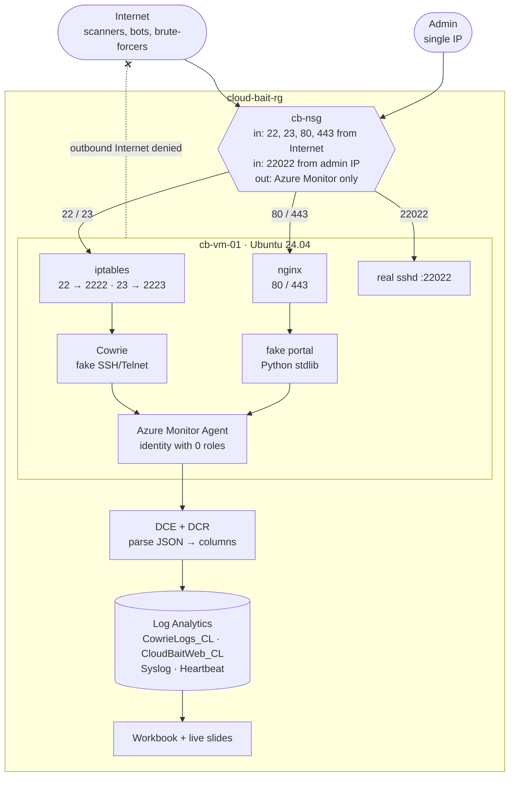
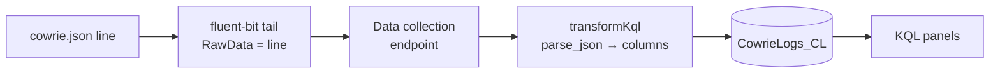
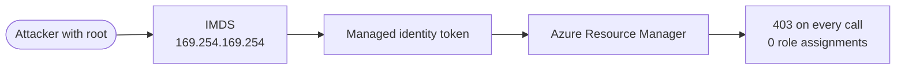

I built a deliberately tempting, deliberately harmless server in Azure, told nobody its address, and wired every keystroke into Log Analytics. This is how it was built, what broke along the way, and what the internet did to it.


**4m 48s** from exposure to first attack

**579** SSH and Telnet sessions

**563** password guesses

**774** commands typed into a fake shell

**23** source IPs

**13** countries

First 71 minutes after exposure (06:07–07:18 UTC). The experiment keeps running until 15 October.

## Contents

1. [Why build a honeypot](#why)
2. [Architecture](#architecture)
3. [Isolation and the network](#isolation)
4. [Getting the real SSH out of the way](#ssh)
5. [Cowrie: the fake shell](#cowrie)
6. [The fake web application](#web)
7. [Telemetry: AMA, DCR and custom tables](#telemetry)
8. [The identity paradox](#identity)
9. [Testing before exposure](#testing)
10. [What the internet did](#results)
11. [Dashboards and a live slide deck](#viz)
12. [Gotchas](#gotchas)
13. [Security lessons](#lessons)
14. [Cost and cleanup](#cleanup)

## 01 Why build a honeypot

I'm opening an introduction-to-cloud-security session, and I wanted to start with evidence instead of slides. The hypothesis was simple:

> Internet-facing cloud workloads receive automated reconnaissance and authentication attempts shortly after exposure, whether or not anyone knows they exist.

A honeypot tests that directly. You run something that *looks* worth attacking, make sure it can't actually be harmed or abused, and record everything. The one principle that shaped every decision below:

Design principle

**The VM is disposable. The telemetry is the asset.** Logs leave the machine within about a minute of being written. If the box is compromised, wiped or deleted, the evidence is already somewhere else.

The second principle followed from the first: **monitoring is verified before anything is exposed**. A honeypot that starts logging an hour late has already lost its most interesting number, the time to first contact.

## 02 Architecture

One small Ubuntu VM in its own resource group, fronted by a network security group. Two deception services run on it: Cowrie for SSH and Telnet, and a fake corporate web portal. The Azure Monitor Agent ships their logs through a data collection rule into a Log Analytics workspace, where KQL turns them into a workbook and a live slide deck.



Everything lives in one resource group, so a single `az group delete` removes the whole experiment.

| Component | Choice | Why |
| --- | --- | --- |
| Compute | Ubuntu 24.04, Standard_B2als_v2, South Africa North | Small and cheap. It's bait, not a workload. |
| SSH/Telnet deception | Cowrie (medium interaction) | Accepts logins into an emulated shell and logs every event as JSON |
| Web deception | nginx → standard-library Python app | Full control of the bait content; no third-party code to exploit |
| Telemetry | Azure Monitor Agent + DCE + DCR | Microsoft's current agent; DCR transforms parse the JSON at ingestion |
| Analysis | Log Analytics + KQL, Azure Workbook | Queryable evidence, with built-in IP geolocation |
| Infrastructure as code | Bash + `az` CLI in phases | Each phase can be verified before the next one runs |

## 03 Isolation and the network

The subscription also hosts unrelated production resource groups, so isolation was the first job, not an afterthought. Everything sits in `cloud-bait-rg`, tagged `delete-after=2026-10-16`, inside its own VNet (`10.50.0.0/16`) with **no peering, no VPN gateway and no private endpoints**. There's no network path from the honeypot to anything else I own.

The NSG is the whole perimeter. Inbound rules allow only the services under observation. Outbound gets more attention, because a compromised honeypot that can reach the internet becomes part of someone else's botnet.

| Rule | Priority | Direction | Ports | Source → Destination | Action |
| --- | --- | --- | --- | --- | --- |
| `Allow-Admin-SSH` | 100 | In | 22022 | admin IP → * | Allow |
| `Honeypot-Ingress` | 200 | In | 22, 23, 80, 443 | Internet → * (admin IP only until go-live) | Allow |
| `Allow-AzureMonitor-Out` | 100 | Out | * | VirtualNetwork → `AzureMonitor` | Allow |
| `Allow-AzureRM-Out` | 110 | Out | 443 | VirtualNetwork → `AzureResourceManager` | Allow |
| `Allow-Entra-Out` | 120 | Out | 443 | VirtualNetwork → `AzureActiveDirectory` | Allow |
| `Deny-Internet-Out` | 4000 | Out | * | * → Internet | Deny |

Service tags keep the monitoring path open while everything else is denied. From the VM, `curl https://example.com` times out, while heartbeats and logs keep flowing. Two side effects are worth knowing:

- **Cowrie can't fetch payloads.** Its emulated `wget` and `curl` make real requests from the VM, so blocking egress blocks them too. You still capture the command and the URL, just not the binary. For a short public demo, I chose safety over a malware collection.
- **DNS still resolves.** Azure's platform resolver at `168.63.129.16` isn't filtered by NSGs. That leaves a theoretical DNS exfiltration channel, which is acceptable on a box holding nothing worth exfiltrating.

The inbound honeypot rule starts locked to my own IP. Opening it to `Internet` is a separate, deliberate step that also records the timestamp:

infra/deploy.sh: expose

```
  az network nsg rule update -g "$RG" --nsg-name "$NSG" -n Honeypot-Ingress \
      --source-address-prefixes Internet -o none
  T=$(date -u +%Y-%m-%dT%H:%M:%SZ)
  echo "EXPOSED at $T" | tee -a "$ROOT/EXPOSURE_TIME.txt"
  # stamp the exposure time into every dashboard query, then redeploy the workbook
  set +f; sed -i "s/^let exposed = todatetime(\"[^\"]*\")/let exposed = todatetime(\"$T\")/" "$ROOT"/queries/*.kql
  "$0" dashboard
```

## 04 Getting the real SSH out of the way

The internet expects SSH on port 22, so Cowrie needs port 22, and the real `sshd` has to move. You never want internet traffic reaching the real daemon on a honeypot.

On Ubuntu 24.04 this has a trap. SSH is **socket-activated**: systemd's `ssh.socket` owns the listening port, so editing `Port` in `sshd_config` does nothing on its own. You have to override the socket unit:

vm/setup.sh

```
mkdir -p /etc/systemd/system/ssh.socket.d
cat > /etc/systemd/system/ssh.socket.d/override.conf <<EOF
[Socket]
ListenStream=
ListenStream=0.0.0.0:22022
ListenStream=[::]:22022
EOF
cat > /etc/ssh/sshd_config.d/10-cloudbait.conf <<EOF
Port 22022
PasswordAuthentication no
KbdInteractiveAuthentication no
PermitRootLogin no
EOF
systemctl daemon-reload
systemctl restart ssh.socket
```

The empty `ListenStream=` clears the default before adding the new one. The NSG rule for 22022 existed before this ran, so there was no window in which I could lock myself out. The admin key is a dedicated ed25519 key generated for this project alone. Only its public half is on the VM.

## 05 Cowrie: the fake shell

[Cowrie](https://github.com/cowrie/cowrie) is a medium-interaction SSH and Telnet honeypot. It accepts logins, presents an emulated filesystem and shell, and logs connections, credentials, commands and download attempts as structured JSON. It runs as an unprivileged `cowrie` user, so it can't bind ports below 1024. iptables redirects the public ports to its listeners instead:

```
iptables -t nat -A PREROUTING -p tcp --dport 22 -j REDIRECT --to-port 2222
iptables -t nat -A PREROUTING -p tcp --dport 23 -j REDIRECT --to-port 2223
netfilter-persistent save
```

The systemd unit adds `NoNewPrivileges`, `ProtectSystem=strict` and a single writable path for its `var/` directory. The persona matters more than you'd expect, and my first draft got it wrong. Cowrie's default filesystem and banner say *Debian*, and I'd set an *Ubuntu* kernel string. Any script that runs `uname -a` and `cat /etc/issue` would see the mismatch, so the final config is consistently Debian 11:

vm/cowrie.cfg

```
[honeypot]
hostname = kd-api-prod01

[shell]
kernel_version = 5.10.0-28-amd64
kernel_build_string = #1 SMP Debian 5.10.209-2 (2024-01-31)

[ssh]
listen_endpoints = tcp:2222:interface=0.0.0.0
version = SSH-2.0-OpenSSH_8.4p1 Debian-5+deb11u3

[telnet]
enabled = true
listen_endpoints = tcp:2223:interface=0.0.0.0
```

That turned out to be relevant: within the first hour, a bot ran a script built specifically to tell real shells from emulated ones. More on that in [the results](#results).

## 06 The fake web application

The web bait is a portal for **Kipeo Digital Services**, a fictional East African payments company. I deliberately didn't use any real brand. It's about 250 lines of Python using only the standard library (`http.server`), behind nginx, which terminates TLS with a self-signed certificate. Scanners don't care about the certificate warning, and there's no dependency tree to patch or exploit.

| Route | What the bot sees |
| --- | --- |
| `/` | Homepage with a "cloud environment" table: api-prod, postgres-prod, customer-storage, backup-prod |
| `/login`, `/admin`, `/wp-login.php`, `/phpmyadmin` | Login form. Every POST returns 401, and the attempted credentials are logged. |
| `/api/v1/{users,customers,transactions}` | JSON like `{"environment":"production","records":12482}` |

| Bait file | Contents |
| --- | --- |
| `/.env` | `APP_ENV=demo`, `DATABASE_HOST=database.internal`. No secrets of any kind. |
| `/backup/` listing | `backup_2026.sql`, `customer_export.csv`…, containing three placeholder IDs |
| `/robots.txt` | `Disallow: /admin`, `/backup`, `/config`: a map of exactly what scanners want |

Every request becomes one JSON line, including the forwarded client IP, the user agent, a truncated body and any submitted credentials. The response headers lie a little (`X-Powered-By: PHP/7.4.3`) to make the target look softer.

app/cloudbait_web.py: one log record

```
{"timestamp": "2026-10-11T05:47:48.877Z", "src_ip": "…", "method": "POST",
 "uri": "/login", "status": 401, "user_agent": "…", "scheme": "http",
 "body": "username=…&password=…", "login_username": "…", "login_password": "…"}
```

One rule I held to: **a honeypot shouldn't be "fully vulnerable".** No ancient OpenSSH, no exploitable PHP, no real credentials. Automated traffic produces reconnaissance, brute force and exploit probing without any of those, and the deception layer captures behaviour without handing anyone a real server.

## 07 Telemetry: AMA, DCR and custom tables

This is where the original plan would have failed quietly. It assumed a Syslog data source would capture the attacks. It wouldn't have: Cowrie writes `var/log/cowrie/cowrie.json` and the web app writes `/var/log/cloudbait/web.json`, and neither goes anywhere near syslog. A Syslog-only DCR shows heartbeats and system noise, and none of the attack data.

The working pipeline uses a **custom text-log data source** for each file. The DCR treats each line as `RawData`, and a **transformKql** parses it into typed columns at ingestion time:



The web log takes the same path into `CloudBaitWeb_CL`. Syslog and Heartbeat go to their built-in tables.

infra/dcr.template.json: Cowrie data flow

```
{
  "streams": [ "Custom-CowrieLogs_CL" ],
  "destinations": [ "cbLaw" ],
  "transformKql": "source
    | extend d = parse_json(RawData)
    | extend ts = todatetime(d.timestamp)
    | project TimeGenerated = iif(isnull(ts), TimeGenerated, ts),
              RawData, Computer, FilePath,
              EventId = tostring(d.eventid), SrcIp = tostring(d.src_ip),
              DstPort = toint(d.dst_port), Session = tostring(d.session),
              Username = tostring(d.username), Password = tostring(d.password),
              Command = tostring(d.input), ClientVersion = tostring(d.version),
              Url = tostring(d.url), Sha256 = tostring(d.shasum)",
  "outputStream": "Custom-CowrieLogs_CL"
}
```

Using the event's own timestamp as `TimeGenerated` means the charts show when the attack happened, not when the agent shipped it. The custom tables have to exist before the DCR can target them. I created them with `az rest` against the workspace tables API, declaring `TimeGenerated`, `RawData`, `Computer`, `FilePath` and every parsed column.

### Three things the agent taught me

- **The first config fetch can be a 404.** I installed the agent extension, then created the DCR association. The agent's first check-in came seconds before the association existed (`Mcs indicated that VM is not associated with the DCR, statuscode: 404`). It retries within minutes, but it looks alarming in the log.
- **File tailing uses a multiline parser.** The generated fluent-bit config attaches a multiline parser that starts a new record on lines beginning with an ISO-8601 timestamp. JSON lines start with `{`, so I expected every record to merge into one. In practice, lines that don't match the start state pass through one per line, which I confirmed by checking `strlen(RawData)` per row. Verify this rather than assume it.
- **Two processes, two users.** `mdsd` runs as `syslog`, while fluent-bit, which tails the files, runs as root. I added `syslog` to the `cowrie` group anyway, so the agent can read the logs whichever process does the reading.

## 08 The identity paradox

The plan said: *don't give the honeypot a managed identity.* The Azure Monitor Agent says otherwise. It authenticates to the ingestion endpoint with one, and associating a DCR through the portal quietly enables a system-assigned identity on the VM.

The fix is to separate *having an identity* from *having permissions*. The VM has an identity so the agent can sign its uploads. It has **zero role assignments at any scope**, which I checked with `az role assignment list --assignee <principalId> --all`.



Least privilege in its purest form: the workload needs no Azure permissions, so it has none.

What remains possible for an attacker with root on the VM: sending junk into this workspace (data poisoning, plus some ingestion cost, which a daily cap would bound) and the DNS path described above. Neither touches the rest of the subscription.

## 09 Testing before exposure

Exposure is a one-way door for the "time to first attack" metric, so everything was tested end to end while the NSG still admitted only my IP. `tests/selftest.sh` generates traffic tagged with a unique ID and then polls Log Analytics until that exact traffic shows up:

```
== Honeypot <ip>, tag cbselftest-1791698472
-- Web (HTTP/HTTPS)
  PASS  GET  http  / (200)
  PASS  GET  http  /.env (200)
  PASS  GET  https /admin (200)
  PASS  GET  http  /api/v1/customers (200)
  PASS  GET  http  /backup/backup_2026.sql (200)
  PASS  POST http  /login (401)
  PASS  .env has no secret-looking values
-- SSH honeypot (port 22 -> Cowrie)
  PASS  Cowrie accepted login and ran fake shell
  PASS  fake uname persona
-- Telnet honeypot (port 23 -> Cowrie)
  PASS  port 23 accepts connections
-- Real admin sshd is NOT on 22
  PASS  port 22 is Cowrie, not the real host
-- Log Analytics ingestion (polls up to 15 min)
  PASS  Heartbeat in last 10m (10)
  PASS  Syslog in last 30m (912)
  PASS  web requests in CloudBaitWeb_CL (7)
  PASS  SSH login + command in CowrieLogs_CL (2)
== 15 passed, 0 failed
```

The scripted SSH login uses `SSH_ASKPASS` with `SSH_ASKPASS_REQUIRE=force` to feed a password non-interactively, with no `sshpass` needed. The order mattered: test, apply the egress deny, **test again**, and only then expose. The second run caught nothing wrong with egress, but it did catch a bug in the test. It expected seven tagged web requests when only six carried the tag, so it waited fifteen minutes for data that had arrived in one.

## 10 What the internet did

The NSG opened at **06:07:20 UTC**. The first connection, an SSH session, arrived at **06:12:08 UTC**. Nobody had been given the address. A scanner simply found it.

> Four minutes and forty-eight seconds. That's how long a new cloud workload stays unnoticed.

Everything below covers the first 71 minutes.

### The noise floor is dominated by a few machines

One IP geolocated to Bulgaria accounted for 501 of 579 sessions, cycling through one password guess and one `uname` every five seconds. "Thousands of attacks" usually means a handful of tireless bots plus a long tail. Being attacked is not evidence of being *targeted*; this is internet background radiation.

| Username | Tries |
| --- | --- |
| `root` | 33 |
| `admin` | 14 |
| `ssm-user` | 3 |
| `sftpuser` | 3 |
| `qniconfiguser` | 3 |
| `navidrome` | 2 |

| Password | Tries |
| --- | --- |
| `admin` | 16 |
| `12345` | 3 |
| `a123456A` | 3 |
| `ranger` | 3 |
| `hcicloud` | 3 |
| `milad` | 3 |

The usernames read like a catalogue of real software: `ssm-user` (AWS Systems Manager), `navidrome` (a self-hosted music server), `qniconfiguser`, `sftpuser`. Wordlists are built from defaults that real products ship with.

### The clients announce themselves

| SSH client version string | Sessions | What it suggests |
| --- | --- | --- |
| `SSH-2.0-Go` | 546 | Go's `x/crypto/ssh`, the library behind most modern brute-force tools |
| `SSH-2.0-libssh_0.9.6` | 7 | C-based scanners |
| `SSH-2.0-OpenSSH_8.9` | 1 | Possibly a human with a normal client, or a bot pretending to be one |
| `SSH-2.0-Fingerprintx-SSH2` | 1 | A service fingerprinting tool doing reconnaissance |

Of 555 identified sessions, 546 came from Go. Not one looked like a person at a keyboard.

### What they ran once "inside"

| Command | Count | Purpose |
| --- | --- | --- |
| `uname -s -v -n -r -m` | 500 | Fingerprint OS, kernel and architecture to pick a payload |
| `/bin/busybox HISILICON` | 21 | Mirai-family check for HiSilicon IoT chipsets (cameras, DVRs, routers) |
| `enable` · `system` · `shell` · `sh` | 14 each | Try to break out of router and embedded CLIs into a real shell |
| A long recon script (below) | 22 | GPU hunting and honeypot detection |

The most interesting artifact was a single multi-line payload, run 22 times. Abridged:

```
arch=$(uname -m || busybox uname -m || …)
cpus=$(nproc || grep -c "^processor" /proc/cpuinfo)
cpu_model=$(lscpu | awk -F: '/Model name/ {print $2}' || …)
gpu_info=$( (lspci | grep -i vga; lspci | grep -i nvidia) 2>/dev/null )
last_output=$(last 2>/dev/null)
filter_output=$( echo '===SHELL_BEHAVIOR===';
  printf 'path_err=';    ( ./xxxxxx 2>&1 || true ) | head -c 250
  printf 'cmd_err=';     ( xxxxxx 2>&1 || true )   | head -c 250
  printf 'execute_err='; bash -c 'printf "#!/bin/bash\necho \"xxxxxx\"\n" > filter
                                   && chmod +x filter && ./filter && rm -rf filter'
  echo '===DONE===' )
echo "GPU:$gpu_info"
echo "FILTER:$filter_output"
```

Two things are going on here:

1. **Resource triage.** CPU count, CPU model and especially `lspci | grep -i nvidia`. A machine with a GPU is worth far more to an attacker, for cryptomining or for reselling AI compute.
2. **Honeypot detection.** The `===SHELL_BEHAVIOR===` block compares the exact error text for a missing path and a missing command, then writes, `chmod`s and executes a script to see whether it really runs. Emulated shells tend to get those edge cases subtly wrong. Bots are being built to recognise tools like Cowrie, and that's why persona consistency matters.

### The web side was quieter

Only five web requests arrived in the first hour, against hundreds of SSH sessions. The first was telling: a request for `/.env.development`, a variant of the dotfile that frameworks use for secrets. SSH brute force is cheap and constant. Web discovery tends to arrive in bursts from crawlers working through IP ranges.

### Geography is not attribution

Traffic came from 13 countries: Bulgaria, Romania, South Korea, India, Bangladesh, Canada, China, Russia and others. KQL's `geo_info_from_ip_address()` makes this a one-liner, and it's easy to over-read. The location belongs to the *machine*, which is usually a compromised device or a rented server, not to the person operating it.

## 11 Dashboards and a live slide deck

All eleven dashboard queries share a header that excludes my own traffic and anchors everything to the exposure time:

queries/\*.kql: shared header

```
let excluded = dynamic(["<admin-ip>"]);
let exposed = todatetime("2026-10-11T06:07:20Z");
let ssh = CowrieLogs_CL | where TimeGenerated >= exposed and SrcIp !in (excluded)
                        and Username !startswith "cbselftest";
let web = CloudBaitWeb_CL | where TimeGenerated >= exposed and SrcIp !in (excluded)
                          and UserAgent !startswith "cbselftest";
```

queries/08_most_suspicious.kql

```
ssh
| summarize Logins=countif(EventId=="cowrie.login.success"),
            Commands=countif(EventId=="cowrie.command.input"),
            Downloads=countif(EventId startswith "cowrie.session.file_download"),
            FirstSeen=min(TimeGenerated) by SrcIp
| where Commands > 0 or Downloads > 0
| extend Score = Commands + 10*Downloads
| top 20 by Score desc
```

A small Node script turns the `.kql` files into an Azure Workbook, "Who is attacking my cloud?", with panels for time to first attack, top credentials, attacker commands, SSH client fingerprints and geography.

For the talk itself I built a separate **live slide deck**: a zero-dependency Node server plus one HTML page with eleven full-screen slides, from the time-to-first-attack hero number through a scrolling live feed to the closing "Welcome to cloud security". It was designed to be safe to run on stage:

- **Local only.** It binds `127.0.0.1`, so nobody on the venue Wi-Fi can reach it.
- **Read-only, no stored secrets.** It calls `az account get-access-token --resource https://api.loganalytics.io`, a token whose audience is the Log Analytics query API and nothing else.
- **Hostile input stays inert.** Every attacker-controlled string (usernames, passwords, commands, URLs) is rendered through `textContent`, never `innerHTML`, and the page sends a strict Content-Security-Policy. When your data source is a honeypot, your dashboard is an attack surface.
- **Privacy and resilience.** IPs are masked to `a.b.x.x`. Each successful refresh is saved to disk, so if the network drops, the slides show the last data with an "offline · as of" label.

## 12 Gotchas

None of these were hard; all of them cost time. In rough order of appearance:

- **Capacity, not quota.** `Standard_B2s` failed with `SkuNotAvailable` (capacity restrictions) in South Africa North. `Standard_B2als_v2` deployed at once. Script a fallback list of sizes.
- **The CLI can hide its own errors.** `az vm create` crashed with `RuntimeError: The content for this response was already consumed`, masking the real `SkuNotAvailable`. Rerunning with `--debug` and grepping for `Exception Details` found it.
- **Windows `az` + Git Bash paths.** `az.exe` can't read `/c/Users/…` paths, so `--ssh-key-values` fell back to treating the path as a literal key and complained it wasn't RSA. Pass file contents, or convert with `cygpath -m`, and set `MSYS_NO_PATHCONV=1` so resource IDs starting with `/subscriptions` aren't mangled.
- **Interactive extension prompts break scripts.** `az monitor data-collection` commands prompt to install an extension, which turns into `EOFError` in a script. Calling the ARM REST API with `az rest` removed the dependency entirely.
- **`set -f` is global.** I disabled globbing so `'*'` in NSG rules wouldn't expand, which also silently broke a later `queries/*.kql` sed. Scope your shell options.
- **Ubuntu 24.04 SSH socket activation.** See [section 04](#ssh). `Port` in `sshd_config` isn't enough.
- **Mermaid isn't Markdown.** A `;` inside a sequence-diagram message ends the statement, and a colon in a Gantt task name breaks the parser. Validate diagrams with `mermaid-cli` before publishing.
- **Front-end temporal dead zone.** The slide deck crashed only when opened directly on the counters slide, because navigation ran before the `const` declarations it touched. A screenshot of every slide via its URL hash caught it.

## 13 Security lessons

The point of the experiment is the talk, and the point of the talk is that the honeypot's defenses are the same ones any real workload needs:

| What protected the honeypot | The general principle |
| --- | --- |
| Cowrie and fake data: attackers "got in" to nothing | Don't keep secrets where they can leak. Assume breach. |
| Own resource group and VNet, no peering | **Network segmentation** limits the blast radius |
| Managed identity with zero roles | **Least privilege**: an identity is not a permission |
| Outbound Internet denied | **Egress control** stops a compromise from spreading |
| Real SSH moved, key-only, one source IP | **Reduce attack surface**; no guessable passwords |
| Logs off the box within a minute | **Centralised monitoring**: you can't defend what you can't see |

And the headline lesson: **obscurity isn't a control.** An unpublicised IP address bought four minutes and forty-eight seconds.

## 14 Cost and cleanup

One B-series VM, a Standard public IP and a few megabytes of log ingestion a day: a few dollars over the life of the experiment. I deliberately left out a daily auto-shutdown, which would break collection every night. The kill switch is `az vm deallocate`, and the evidence is already safe in Log Analytics. After the presentation:

```
az group delete -n cloud-bait-rg --yes
```

That removes the VM, network, workspace and dashboards in one go, so export the screenshots and query results first.

### Repository layout

```
app/cloudbait_web.py     fake web app (stdlib Python, JSON request log)
vm/setup.sh              provisioning: sshd move, Cowrie, iptables, nginx, app
vm/cowrie.cfg            Cowrie persona
infra/deploy.sh          az phases: network | vm | monitor | egress | dashboard | expose
infra/dcr.template.json  Syslog + custom text logs with transformKql
infra/table-*.json       custom table schemas
queries/*.kql            11 dashboard queries
tests/selftest.sh        end-to-end test, services + ingestion
presenter/               local live slide deck
```

Operation: Cloud Bait ran from 11 to 15 October 2026 in an isolated Azure resource group. All data served by the honeypot was synthetic, and attacker IP addresses are omitted or masked. If you build your own, keep the order: isolate, monitor, test, then expose.

Full code and architecture can be found in my [GitHub](https://github.com/0tieno/honeypot).

Happy hacking!